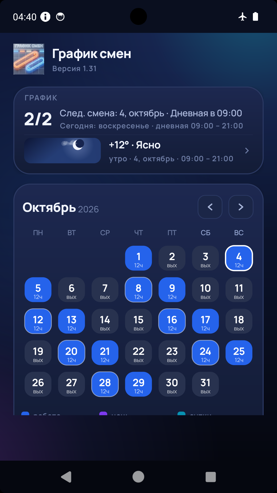
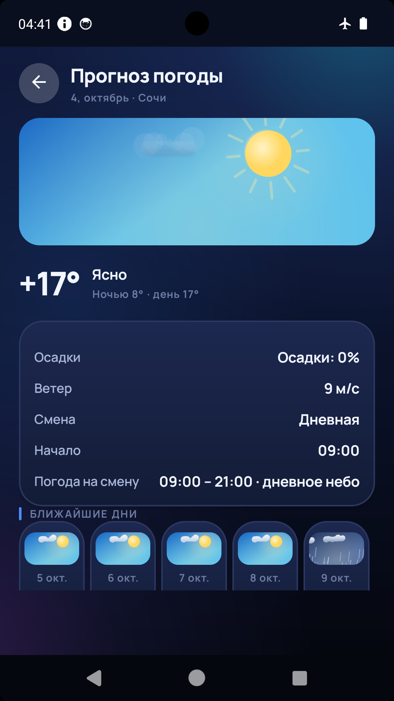
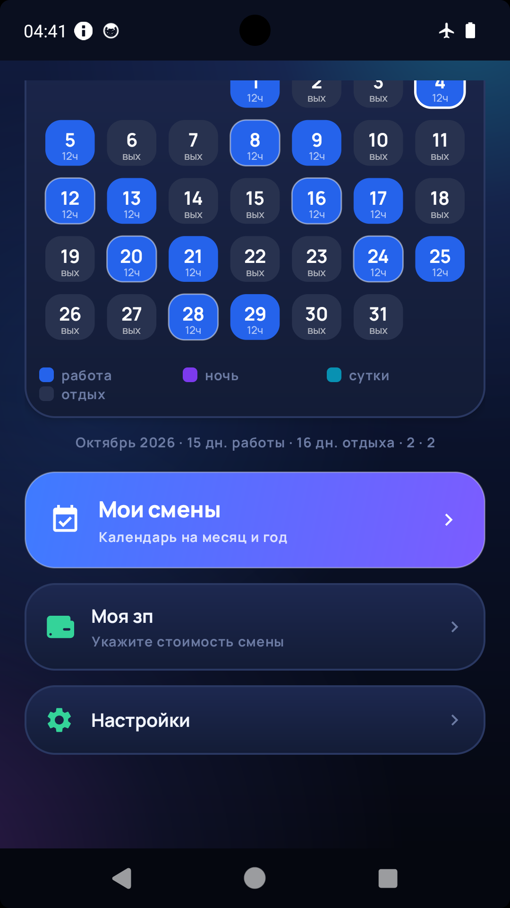

# График смен

Расписание смен, календарь рабочих и выходных дней, будильник к началу смены
и погода на время ближайшей смены.

**Страница приложения:** https://takomak2012-cyber.github.io/GrafikSmen/

| | |
|---|---|
| Версия | 1.36 (versionCode 37) |
| Имя пакета | `com.grafik.smen` |
| Требуется | Android 7.0 (API 24) и выше |
| Целевая версия | Android 15 (API 35) |
| Архитектура | универсальный APK, нативных библиотек нет |
| Язык | русский |
| Реклама | один баннер РСЯ (Yandex Mobile Ads SDK 8.6.0) |

## Возможности

- **Готовые графики:** 2/2, 5/2, 6/1, 3/3, день-ночь-48, сутки-трое.
- **Свой график:** дни цикла отмечаются в календаре, программа собирает из них цикл —
  дневные, ночные и суточные смены.
- **Календарь на месяц и год** с цветовой маркировкой: дневная, ночная, суточная смена,
  выходной, отпуск, больничный.
- **Ручные отметки дней** не сбивают основной график.
- **Ночные и суточные смены** через полночь, смены на 24 часа, своё время
  начала и окончания для каждого вида смены.
- **Будильник на рабочие дни** ставится через `setAlarmClock`, обходит «Не беспокоить»
  и беззвучный режим. Напоминание — отдельно, за 15 минут, полчаса, час, два часа или сутки.
- **Расчёт заработка** по стоимости смены за выбранный период.
- **Погода на время ближайшей смены:** MET Norway, при недоступности —
  WeatherAPI.com, затем Open-Meteo, при отсутствии сети — последние сохранённые данные.
  Город выбирается из списка 1117 городов России или определяется по геолокации.
- **Работает без интернета:** график, календарь, будильник и расчёты полностью автономны.

## Скриншоты

| Главный экран | Погода | Календарь |
|---|---|---|
|  |  |  |

## Установка

1. Скачайте `GrafikSmen_v1.36.apk` из раздела Releases.
2. Разрешите установку из неизвестных источников для того приложения, из которого открываете файл.
3. Откройте файл и подтвердите установку.

Приложение подписано ключом разработчика, поэтому обновление ставится поверх
предыдущей версии без потери настроек.

## Что нового

**1.36**
- После отмены ближайшего будильника кнопка «Отменить будильник» исчезает
  и появляется снова только после смены настроек будильника или графика.
- Кнопка отмены показывается не ранее чем за сутки до начала ближайшей смены.

**1.35**
- Исправлен случай, когда будильник не срабатывал совсем: без системного разрешения
  на точные будильники приложение теперь ставит приближённый сигнал, а не отказывается планировать его.
- Если точные будильники недоступны, за 20 минут до смены приходит страховочное уведомление.
- На главном экране появляется подсказка с кнопкой «Разрешить», чтобы сигнал срабатывал точно.

**1.34**
- На главном экране появилась кнопка «Отменить будильник» рядом с названием приложения.
  Кнопка показывается только если будильник в приложении действительно задан.
- Отмена ближайшего будильника: сигнал снимается, а следующий рабочий будильник ставится сразу.

**1.33**
- Рекламный баннер занимает всю ширину экрана, а не ширину колонки интерфейса.
- Уменьшены боковые отступы интерфейса.
- Обновлён Yandex Mobile Ads SDK до 8.6.0.

## Политика конфиденциальности

См. [PRIVACY.md](PRIVACY.md). Личные данные никуда не отправляются, расписание хранится
только на устройстве.

## Лицензия и авторство

© Вячеслав Долар. Приложение распространяется бесплатно.

## Связь

<takomak2012@gmail.com>